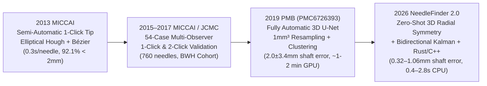

# NeedleFinder Project Overview

## 1. Clinical Context
In **MR-guided interstitial gynecologic brachytherapy** (performed in the AMIGO suite at Brigham and Women's Hospital), between **6 and 28 plastic tungsten-alloy-obturated catheters** (typical outer diameter $1.5\text{–}2.0\text{ mm}$) are inserted through a perineal template (Syed-Neblett) and/or vaginal obturator into cervical/uterine/vaginal tumors.

High-dose-rate (HDR) treatment planning requires millimeter-accurate 3D localization of every catheter trajectory and tip on intraoperative 3T T2-weighted turbo spin-echo (TSE) MRI. Because steep dose gradients ($\approx 6\text{–}12\%/\text{mm}$) surround the $\text{^{192}Ir}$ source dwell positions, a **$2\text{ mm}$ catheter localization error translates into $>10\text{–}20\%$ dosimetric deviation** to the clinical target volume (CTV) or adjacent organs at risk (bladder, rectum, sigmoid).

### Technical Challenges in Intraoperative T2W MRI
1. **Anisotropic Voxel Spacing**: Intraoperative T2W volumes typically have fine in-plane resolution ($0.23\text{–}0.625\text{ mm}$) but thick slices ($1.6\text{–}3.0\text{ mm}$).
2. **Dark Susceptibility Void Ambiguity**: Plastic catheters appear as small signal voids ($1.5\text{–}2.5\text{ mm}$ diameter) that mimic blood vessels, surgical sutures, air pockets, and partial-volume tissue boundaries.
3. **Dense Multi-Needle Packing & Crossings**: Up to 26 catheters are packed within a $5\times 5\text{ cm}$ pelvic cross-section, leading to closely parallel shafts ($<4\text{ mm}$ spacing) and apparent trajectory crossings.
4. **Intraoperative Time Constraints**: Manual segmentation of 15–25 catheters takes $15\text{–}30\text{ min}$ of physicist/clinician time while the patient is under general anesthesia.

---

## 2. Algorithmic Evolution (2012–2026)

| Generation | Key Innovation | Main Limitation Solved by Next Generation |
|---|---|---|
| **[[wiki/entities/miccai-2013-pernelle\|MICCAI 2013]]** | Semi-automatic tracking from a single clinician tip click; 2D multi-scale elliptical Hough transform + Rayleigh PDF weighting + 3D cubic Bézier fitting. | Required manual identification and clicking of every needle tip ($10\text{–}25$ clicks/case). |
| **[[wiki/entities/jcmc-2017-mastmeyer-pernelle\|JCMC 2017]]** | Validated across 54 clinical cases (760 needles) with multi-observer ground truth (`CY`, `LB`, `AMe`). | Still semi-automatic; sensitive to slice thickness $>2.5\text{ mm}$. |
| **[[wiki/entities/pmb-2019-zaffino-pernelle-pmc6726393\|PMB 2019 (PMC6726393)]]** | First fully automatic 3D U-Net voxel classifier + morphological skeletonization & polylines. | Isotropic $1.0\text{ mm}^3$ resampling blurred sub-millimeter in-plane resolution, yielding $2.0 \pm 3.4\text{ mm}$ average shaft error, $6.7\%$ false positives, and GPU dependency. |
| **[[wiki/research/2026-10-21-auto-needle-detection-evaluation\|2026 Auto-Detect]]** | Native-resolution 3D directional radial symmetry filter + bidirectional seed tracking + Kalman/cubic polynomial smoothing + Rust/C++17 multi-threading. | Eliminates GPU/training data requirement, preserves sub-millimeter in-plane accuracy ($0.32\text{–}1.06\text{ mm}$ shaft error), and runs in $0.39\text{–}2.76\text{ s}$ on CPU. |

---

## 3. Core Architecture of NeedleFinder (2026)
- **`NeedleFinder.py`**: 3D Slicer scripted module GUI, interactive single-needle tools, and one-click `"Auto-Detect All Needles"` workflow.
- **`NeedleFinderLib/TrackingAlgorithms.py`**: Mathematical pipeline (`NeedleFinderLogic`), combining 10 single-needle tracking algorithms (`roi_center`, `gaussian_COM`, `rayleigh`, `sym_line`, `hough`, `template_match`, `kalman`, `hessian_tubular`, `particle_filter`, `graph_dp`) and the fully automatic whole-volume detector (`autoDetectAllNeedles`).
- **`NeedleFinderLib/RustCore.py` & `rust_core/` / `cpp_core/`**: Native multi-threaded Rust (`rayon`) and C++17 (`std::thread`) shared libraries (`libneedlefinder_rust.so/.dylib`) with zero-copy VTK buffer caching (`get_volume_f64_buffer`), accelerating the 3D radial symmetry filter by **$20\times\text{–}61\times$**.
