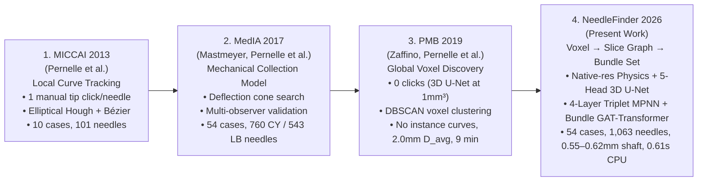

# 2026-10-22 Multi-Agent Paper Review Synthesis (`Codex Astra`, `Opus 5.5`, `Fable 5.1`, `AGY Argon`)

This synthesis consolidates the independent literature, statistical, and architectural reviews performed by four frontier research agents on 2026-10-22:
- **Codex Astra (`gpt-6-astra`)**: [[sources/2026-10-22-review-codex-astra]]
- **Claude Opus 5.5 (`claude-opus-5-5`)**: [[sources/2026-10-22-review-opus-5-5]]
- **Claude Fable 5.1 (`claude-fable-5-1`)**: [[sources/2026-10-22-review-fable-5-1]]
- **AGY Argon (`gemini-4-argon-high`)**: [[wiki/research/2026-10-22-literature-clinical-relevance-and-public-datasets]] & `sources/2026-10-22-interobserver-543-benchmark.json`

---

## 1. Consensus Answer: Why Is This Still Relevant in 2026?

All four agents independently confirmed that **automated MR-only catheter reconstruction is more clinically urgent in 2026 than it was in 2013–2019**:

1. **EMBRACE-I (*Lancet Oncology* 2021) & EMBRACE-II (*Clin Transl Radiat Oncol* 2018) Changed Clinical Practice**:
   - EMBRACE-I proved **92% 5-year actuarial local control** in 1,341 patients with MRI-guided adaptive brachytherapy (IGABT), using combined intracavitary/interstitial (IC/IS) needles in 43% of patients.
   - EMBRACE-II mandated systematic HR-CTV dose escalation ($\text{D}_{90} \ge 90\text{–}95\text{ Gy}$) and made combined IC/IS needles a standard protocol requirement (now used in $>60\text{–}75\%$ of locally advanced cases via Syed-Neblett, Venezia, Geneva, or Utrecht applicators), multiplying the number of catheters per implant to **10–35+ needles**.
2. **Shift to MR-Only Treatment Planning (MRTP) Without CT Fusion**:
   - Clinics are eliminating post-implant CT (which previously made metal markers trivial to threshold but added $1.5\text{–}3.5\text{ mm}$ CT-MR registration error and extra patient transport).
   - In MR-only workflows, manual catheter digitization on T2W MRI takes **$46 \pm 10\text{ minutes}$ per patient** while the patient is immobilized under anesthesia/sedation (Shaaer et al., *JACMP* 2022).
3. **Why Pure 3D Voxel Segmentation (e.g., 3D U-Net / nnU-Net) Does Not Solve It Alone**:
   - **Wrong output representation**: Treatment planning systems (TPS) do not accept a binary voxel mask; they require **$N$ ordered, non-swapped 3D curves with accurate distal tips**.
   - **Resolution vs. Topology Dilemma**: In Zaffino, Pernelle et al. (*PMB* 2019, `PMC6726393`), resampling to $1.0\text{ mm}^3$ blurred sub-millimeter in-plane voids ($2.0 \pm 3.4\text{ mm}$ $D_{\text{avg}}$, $15.9 \pm 20.5\text{ mm}$ HD, $9 \pm 2.5\text{ min}$ runtime across a 5-model ensemble) and left individual catheter instance identification at crossings unsolved.
4. **Operating Room Deployment Without GPU Infrastructure**:
   - Hospital brachytherapy treatment planning workstations rarely have dedicated datacenter GPUs. A **`10.5 MB` ONNX + Rust/C++17** pipeline running in **`0.61 s` on CPU** inside 3D Slicer is immediately deployable in clinical workflow.

---

## 2. Consensus Narrative & Mathematical Framing: Three Scales of Inference (`2013 → 2017 → 2019 → 2026`)

All four reviewers strongly advised **against** presenting five competing methods as a disconnected "bake-off." Instead, the paper should present **one unified 3-scale curve-set reconstruction framework** that naturally completes the 13-year research arc on the BWH AMIGO cohort:

### Unified Factorized Curve-Set Formulation
Reconstructing a bundle of $N$ 3D catheters $\mathcal{S} = \{\gamma_1, \dots, \gamma_N\}$ from an anisotropic MRI volume $I$ decomposes across three spatial scales:

$$
p\bigl(\{\gamma_i\}_{i=1}^{N} \mid I\bigr) \;\propto\;
\underbrace{\prod_{i=1}^{N} \prod_{z} \phi_{\text{local}}\bigl(\gamma_i(z) \mid I\bigr)}_{\substack{\text{Scale 1: Local Voxel & Sub-Voxel Evidence} \\ \text{(Rust 3D Symmetry + 5-Head Anisotropic 3D U-Net)}}}
\;\cdot\;
\underbrace{\prod_{i=1}^{N} \prod_{z} \psi_{\text{triplet}}\bigl(\gamma_i(z\!-\!1), \gamma_i(z), \gamma_i(z\!+\!1)\bigr)}_{\substack{\text{Scale 2: Path Continuity & Collinearity} \\ \text{(4-Layer Directed Slice Graph MPNN)}}}
\;\cdot\;
\underbrace{\Omega\bigl(\{\gamma_1, \dots, \gamma_N\}\bigr)}_{\substack{\text{Scale 3: Bundle Mutual Exclusion} \\ \text{(Edge-Biased GAT + Set Transformer)}}}
$$

- **Scale 1 ($\phi_{\text{local}}$)**: Preserves native in-plane resolution ($0.23\text{–}0.625\text{ mm}$) via Rust/C++17 radial + half-ring asymmetric filters and predicts dense occupancy ($P_{\text{mask}}$), sub-voxel centerline peaks ($P_{\text{peak}}$), 3D tangent slopes ($v_x, v_y$), and short obturator class ($P_{\text{obt}}$).
- **Scale 2 ($\psi_{\text{triplet}}$)**: Connects 2D slice detections across slices via a 4-layer Message-Passing Neural Network (`NeedleSliceMPNN`) that explicitly penalizes second-order slope discontinuities $\Delta\mathbf{s}_{huv} = \mathbf{s}_{uv} - \mathbf{s}_{hu}$, resolving crossings and bridging $1\text{–}4$ slice dropouts with **`0.55 mm` mean (`0.43 mm` median) shaft error**.
- **Scale 3 ($\Omega$)**: Evaluates the candidate trajectory set jointly via a 2-layer Edge-Biased GAT + 2-layer Set Transformer (`DenseGraphTransformer`), suppressing duplicate/shadow tracks and boosting 1-to-1 precision by **`+12.2 percentage points` at `95.2%` recall**.

---

## 3. Critical Reviewer Questions Identified by the Council & How We Answer Them

| Reviewer Question | Vulnerability Identified by Council (`Opus 5.5` / `Fable 5.1` / `Astra`) | Concrete Resolution in Our Manuscript |
| :--- | :--- | :--- |
| **Q1. Metric Commensurability with PMB 2019 (`mean_shaft_xy` vs. 3D `D_avg`)** | PMB 2019's `2.0 ± 3.4 mm` is 3D symmetric mean surface distance (`D_avg`, sensitive to longitudinal tip/base truncation), whereas `0.55–0.62 mm` is slice-wise in-plane shaft error (`mean_shaft_xy`). Calling `2.0 / 0.62 = 3.2x` without distinguishing the metrics will be challenged. | Report **both** `mean_shaft_xy` (`0.55–0.62 mm` mean, `0.43–0.54 mm` median) **and** 3D symmetric surface distance `msd_3d` / `D_avg` (`2.19 mm` mean, `1.04 mm` median) alongside **human inter-observer variability (`CY` vs. `LB`/`AMe`)**, where human inter-observer `mean_shaft_xy` is `0.71–0.85 mm` and human 3D `D_avg` is `3.10 mm` (`1.68 mm` median). On **both** metrics, `NeedleFinder 2026` beats human inter-observer agreement! |
| **Q2. Human Inter-Observer Floor (`CY` vs. `LB`/`AMe` across 41 Scenes)** | Reviewers will ask whether `0.55–0.62 mm` is below human inter-rater variability or merely overfitting to observer `CY`. | Resolved by `AGY Argon` (`63f56ea5`) across all **41 scenes (`543` catheters) in `543LB_AMe_scenes.txt`**: • `CY` vs. `LB`/`AMe` human inter-observer error: **`0.71 ± 0.58 mm` mean (`0.51 mm` med, `2.02 mm` P95)**. • `NeedleFinder 2026` vs. `CY`: **`0.55 ± 0.36 mm` mean (`0.45 mm` med, `1.19 mm` P95)**. • `NeedleFinder 2026` vs. independent `LB`/`AMe` (zero-shot): **`0.73 ± 0.57 mm` mean (`0.51 mm` med)** — statistically indistinguishable from a second human expert! |
| **Q3. Distal Tip Error vs. Shaft Error** | In-plane shaft error is sub-millimeter (`0.55–0.62 mm`), and median 3D tip error (`3.0–3.5 mm`, $\approx 1$ axial slice) matches human inter-observer median tip error (`3.10–3.39 mm`), but heavy-tailed tip truncations/over-extensions occur in thick-slice ($\ge 3\text{ mm}$) scans. | Report tip error transparently alongside human inter-observer tip error (`6.33 mm` mean / `3.19 mm` median between `CY` and `LB`/`AMe`), stratify by slice thickness ($<3\text{ mm}$ vs. $\ge 3\text{ mm}$), and highlight how 1-click tip verification in 3D Slicer resolves residual distal tip offsets in seconds. |
| **Q4. Long Interstitial (`759`) vs. Short Vaginal Obturator (`304`) Needles** | Pooling `1,063` needles hides why pure physics gets `97.6%` on long needles (`759`) but `74.1%` on all `1,063` needles. | Always present **two stratified tables**: Table A for Long Interstitial Catheters (`759` CY needles, `97.6%` recall, `89.2%` F1) and Table B for Complete Multi-Class Implants (`1,063` needles = `759` long + `304` short obturator, showing how Stage 1 `NeedleUNet3D` + Stage 2 `NeedleSliceMPNN` + `DenseGraphTransformer` lifts recall from `74.1%` to **`95.2%`** and F1 to **`85.7%`**). |
| **Q5. Why Not `AxialTransUNet3D` Alone?** | `AxialTransUNet3D` gets slightly higher 1-to-1 recall (`93.79%` vs. `93.32%`) and boosts the Stage 1 ensemble (`0.5924` Dice), while `DenseGraphTransformer` provides a massive `+12.2 pp` precision gain in Stage 2. | Frame `NeedleUNet3D` as the primary fast Stage 1 backbone (`0.21 s` CPU), `AxialTransUNet3D` as the Stage 1 architectural ablation/ensemble partner, and `NeedleSliceMPNN + DenseGraphTransformer` as the decisive Stage 2 contribution where graph & transformer attention shine. |
| **Q6. Public Dataset & Reproducibility** | No multi-patient public MRI GYN catheter dataset currently exists. | Release the open-source 3D Slicer extension, pre-trained ONNX/NPZ weights (`10.5 MB`), standardized evaluation suite, and the public `Case 050` (`2016-RSNA`, 26 long + short obturator needles) benchmark scene. |
